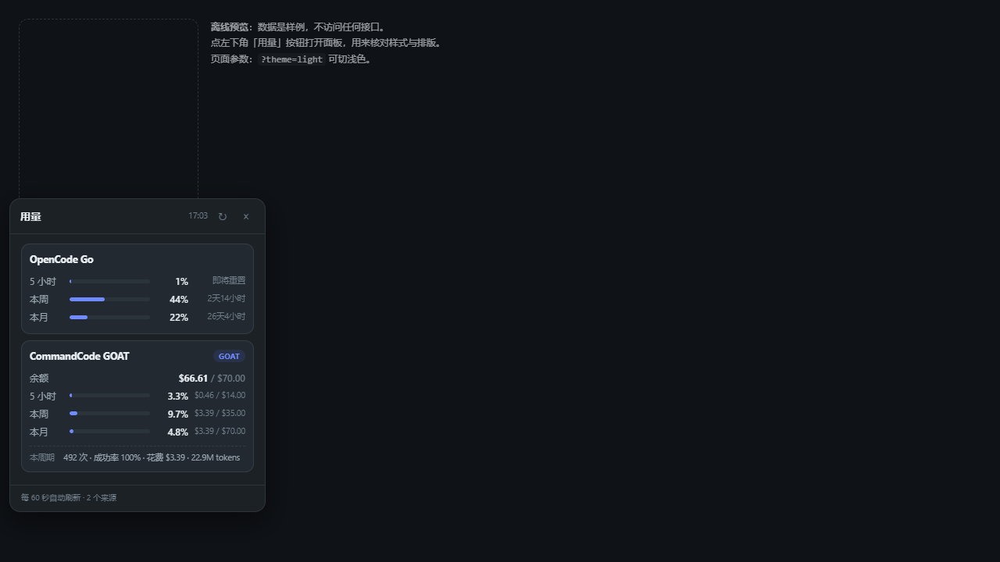
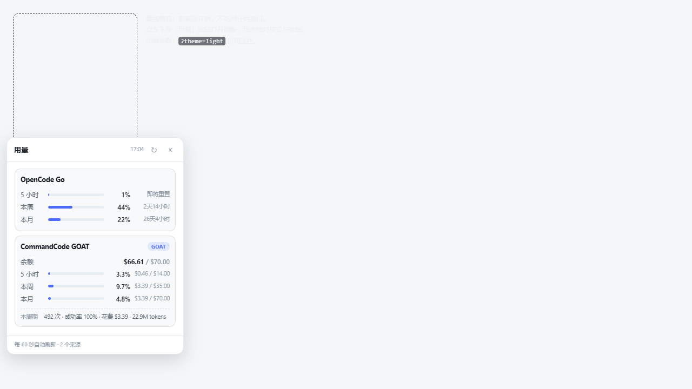

# dsh-usage-hub

DeepSeek Harness（DSH）的**订阅用量面板**：侧边栏底部一个「用量」按钮，点开就能同时看到
**OpenCode Go** 和 **CommandCode GOAT** 的 5 小时 / 每周 / 每月额度、剩余金额、重置倒计时，
以及 CommandCode 本计费周期的请求数、成功率与花费。

数据全部由**你自己的 API key** 直接向两家官方接口查询，不经过任何第三方服务器，也不落盘。



<details>
<summary>浅色主题</summary>



</details>

```
侧栏底部：[▁▃▅] 用量        ← 点一下
           ┌──────────────────────────────┐
           │ 用量                   12:03 ↻ ×│
           ├──────────────────────────────┤
           │ OpenCode Go                  │
           │ 5 小时 ▓░░░░  1%     58 分    │
           │ 本周   ▓▓▓░░ 44%  2天11小时   │
           │ 本月   ▓░░░░ 22%  25天5小时   │
           ├──────────────────────────────┤
           │ CommandCode GOAT        GOAT  │
           │ 余额        $66.61 / $70.00   │
           │ 5 小时 ▓░░░░ 3.3%  $0.46 / $14│
           │ 本周   ▓░░░░ 9.7%  $3.39 / $35│
           │ 本月   ░░░░░ 4.8%  $3.39 / $70│
           │ 本周期 492 次 · 成功率 100% …  │
           └──────────────────────────────┘
```

## 数据来源

| 服务商 | 端点 | 认证 |
|---|---|---|
| OpenCode Go | `GET {baseURL}/usage` | `Authorization: Bearer <OPENCODE_GO_API_KEY>` |
| CommandCode | `GET https://api.commandcode.ai/alpha/billing/credits` | `Authorization: Bearer <COMMANDCODE_GOAT_API_KEY>` |
| | `…/alpha/billing/subscriptions`、`…/alpha/usage/summary`、`…/alpha/whoami` | 同上 |

* OpenCode 的 `rolling / weekly / monthly.percent` 就是控制台里的 5 小时 / 每周 / 每月用量百分比。
* CommandCode 的 `windowLimits.fiveHour|weekly` 是「已用 / 上限」，月度额度取自套餐
  （Go $10 / GOAT $70 / Pro $30 / Max $150 / Ultra $300），剩余额度来自 `credits.monthlyCredits`。
* 两个端点都是**只读**的：本插件不发任何写请求，也不读取或上传你的会话内容。

## 密钥从哪里来

插件**不保存密钥**，而是走 DSH 自己的凭据服务：

1. 读 `llm-pi-ai` 设置里各 provider 的 `apiKeyEnv`（就是你在「设置 → 模型」里给这个 provider
   配的引用名）；
2. 用 `ctx.credentials.resolve(引用名)` 取出真正的 key；
3. 认的 provider 名：`opencode-go` / `opencode` / `opencode-zen`，以及
   `commandcode-goat` / `commandcode-go` / `commandcode-pro` / `commandcode-claude`；
4. 都没配时回退到 `OPENCODE_GO_API_KEY` 和 `COMMANDCODE_GOAT_API_KEY`。

所以换 key、换 provider 名都不用改插件。

## 安装

前置：一个带 web 服务的 DSH（桌面版，或 `dsh web`）。

```bash
dsh plugin --profile desktop add github:unison777/dsh-usage-hub
```

没有 CLI 的话，在 DSH 的 **设置 → 插件** 里用同一个 spec 安装。装完刷新页面
（Ctrl/Cmd+R）让客户端半生效；宿主半由 DSH 的 Loader 自动重载。

## 排错

| 现象 | 原因 / 处理 |
|---|---|
| 侧栏没有「用量」按钮 | 客户端半只在**新页面加载**时注册。刷新页面；仍没有则是 `sidebar.footer.action` 槽位被别的插件占了，看控制台警告。 |
| 面板显示「暂时取不到：凭证无效或已过期（HTTP 401）」 | 该 provider 的 key 过期或被吊销；去设置里换 key。 |
| 「未配置 XXX_API_KEY」 | 设置 → 模型里这个 provider 没填 key，且环境变量里也没有。 |
| 「webServer 不可用」 | 宿主半启动日志里出现，说明当前 profile 没有 web 服务（不是 web 桌面端），界面无从取数。 |
| 数字不动 | 宿主侧 60 秒缓存；面板每 60 秒拉一次。点 ↻ 会强制刷新（但 60 秒内的结果仍来自缓存）。 |
| 面板配色不对 | 面板按 `document.body` 背景色自动判明暗；也可在元素上手动设 `data-uh-theme="dark"`。 |

宿主日志前缀：`[dsh-usage-hub]`。

## 开发

```bash
node --test            # 单元测试（纯函数，不需要网络）
npm run preview        # 打开 test/harness.html 离线预览面板（样例数据，不连接口）
```

`npm run preview` 会起一个只读静态服务（`http://127.0.0.1:8791/test/harness.html`），
用真实 React 渲染 `client.js`，不用装进 DSH 就能调样式；加 `?theme=light` 看浅色。

Windows 上想把源码反复装进本机 profile，可以用 `scripts\deploy-local.ps1`：
打包成 tarball → 覆盖 profile 里的安装副本 → 同步清单与 lockfile，幂等且会校验
`client.js` 与源码一致；`-Profile` 可指向别的 profile。

联调真实接口：

```powershell
$env:USAGE_HUB_LIVE='1'
$env:OPENCODE_GO_API_KEY='...'
$env:COMMANDCODE_GOAT_API_KEY='...'
node --test
```

结构：

```
index.js            宿主半：取钥 → 请求两家 → 归一化 → 同源只读路由 /api/usage-hub
lib/normalize.js    纯函数：原始响应 → 统一窗口结构（含单测）
lib/report.js       纯函数：快照 → 给 agent 看的纯文本（usage_report 工具用）
client.js           客户端半：侧栏按钮 + 浮层面板（纯 DOM，避免被侧栏裁剪）
cordis.patch.yml    bundle 层：insert 一行插件入口
```

另外注册了一个只读工具 `usage_report`，可以直接在对话里问「我这两个订阅还剩多少」。

## License

MIT
